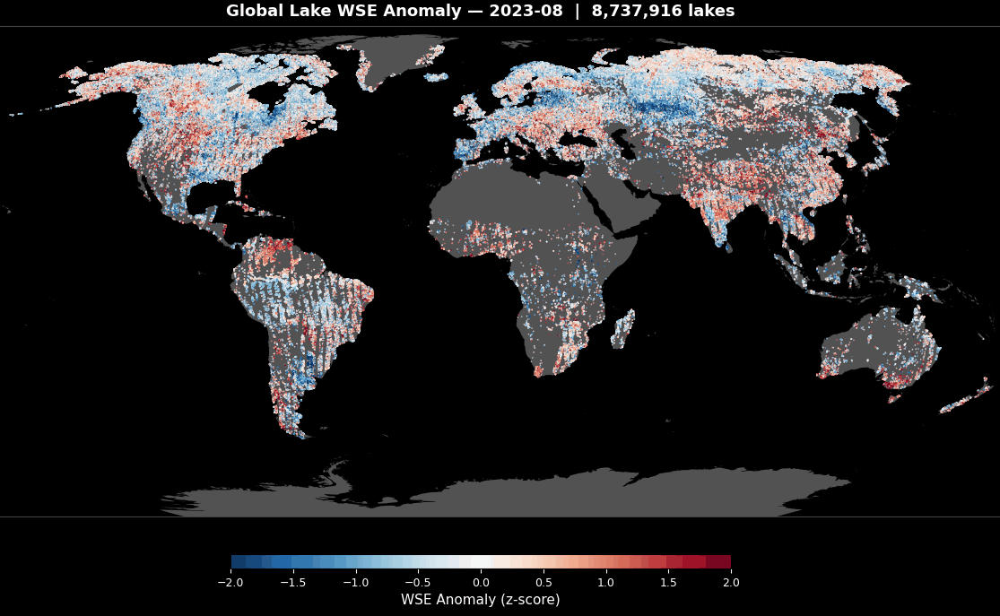
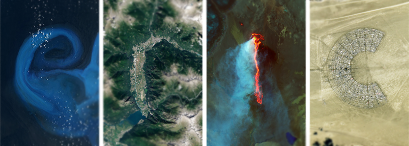



I am a geographer, which -- as Hal Mooney suggested -- means that I am, "concerned with the changing spatial organization and material character of Earth's surface." Currently, I am a Postdoctoral Researcher at the University of North Carolina at Chapel Hill where I work on NASA projects to develop new capabilities for monitoring Earth's water cycle. Previously, I completed my PhD at the University of Oregon with Dr. Sarah Cooley and her <a href="https://sites.duke.edu/coollab/" target="_blank">research group</a> at Duke University's Division of Earth and Climate Sciences at the Nicholas School of the Environment.

The lure to<a href="/files/Earth-from-Space.pdf"> watch Earth from space</a> is strong, for both the beauty and the insight available from a satellite's point of view: 

 For the first time ever, we can watch water levels rise and fall in lakes globally. The pulse of Earth's lakes is dramatic to watch, and it's just one example of how satellite-based research can feel like ilming a natural phenomenon -- such as a sunset or flood, while also enabling fulfilling science. This animation is only possible because of the recent launch of the SWOT satellite, which measures water surface elevation and extent in Earth's lakes, rivers, and oceans.

 
 Sometimes, though, it's worth ditching the satellites and taking a closer look at things.

  
 
  
 
  
 
 
<em>"Who would not choose to follow the sound of running waters? ...I can lean on the rail of a little bridge over a brook and contemplate its currents, its whirlpools, and its steady flow for as long as you like; with no sense or fear of that other flowing within and about me, that swift gliding away of time." -Thomas Mann</em> 

Thanks for visiting, 

